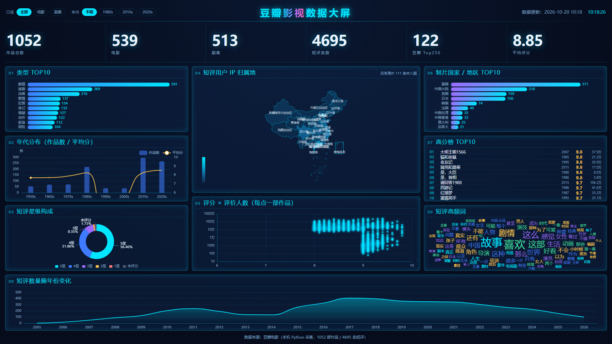

# 豆瓣高分影视数据采集与文本分析

> 从零写爬虫抓了 **1052 部**高分影视资料 + **4695 条**热门短评，做了一个 9 张图、可离线演示的
> 可视化大屏，再用短评文本训练 7 个模型去预测星级 —— 结论是：**文本能判题材，却几乎判不了态度。**



---

## 一句话结论

短评文本里确实有"态度"信息，但弱得不足以做实用分类器：最好的模型 AUC **0.6465**、准确率
**60.6%**，只比"全猜 5 星"（57.5%）高 3.1 个百分点，而且**没有跑赢一个完全不读文本的规则**
（同片其他短评的多数票，61.2%）。同一批文本、同一个模型，换成判断**题材**，准确率立刻升到 **78.5%**。

| 指标 | 数值 |
| --- | --- |
| 抓取作品 | 1052 部（电影 539 / 剧集 513） |
| 热门短评 | 4695 条，覆盖 939 部 |
| 含五星~一星评分分布 | 942 部 |
| 豆瓣 Top250 收录 | 122 部 |
| 可视化大屏 | 9 张图 + 6 组 KPI + 顶部筛选条，离线双击可看 |
| 文本模型 | 7 个，5 折交叉验证全部 out-of-fold 指标 |
| 最佳模型 | TF-IDF 字(2,3) + 逻辑回归：准确率 0.6060 / macro-F1 0.5990 / AUC 0.6465 |

---

## 目录结构

```
.
├── 00_先看这里.md              阅读顺序与材料导航（3 分钟了解全貌）
├── 01_可视化大屏/              ECharts + HTML/CSS/JS，双击 index.html 即可离线演示
│   ├── index.html              入口
│   ├── css/style.css           全部配色集中在 :root 变量里
│   ├── js/charts.js            每张图一个函数（含筛选状态与排名表）
│   ├── js/main.js              舞台缩放 / KPI 填充 / 筛选按钮 / 自适应
│   ├── js/data.js              由分析脚本生成的图表数据（本地化，免服务器；含筛选用的 filters）
│   ├── js/china-map.js         中国地图 GeoJSON（本地化）
│   ├── js/lib/                 ECharts 5.5.1 与词云插件（本地化，所以离线可用）
│   ├── 说明文档.md             逐个文件讲"哪段代码控制什么"，方便自己改 UI
│   ├── 预览截图.png            静态截图
│   └── 改版对比_20261020.png   视觉改版前后对照
├── 02_分析报告/                三份 Markdown 报告 + 6 张模型诊断图
│   ├── 报告.md                 四步完整报告（采集 → 清洗 → 可视化 → 建模）
│   ├── 建模报告.md             建模细节：7 模型对比、换分界线诊断、为什么判不了态度
│   ├── 数据说明.md             字段字典、覆盖度缺口、质量自检
│   └── 图表/                   fig1~fig6
├── 03_汇报PPT/                 16 页汇报 PPT + 16 张图片版预览（没装 Office 也能看）
├── 04_数据成品/                CSV / Excel 成品数据
│   ├── douban_movies.xlsx      两个工作表：作品 / 短评
│   ├── movies.csv              1052 部作品 × 36 列
│   ├── comments.csv            4695 条短评
│   ├── analysis_movies.csv     清洗+特征工程后：1052 × 60 列
│   ├── analysis_comments.csv   清洗+特征工程后：4695 × 26 列
│   └── predictions.csv         模型逐条预测明细
└── 05_源代码/
    ├── 采集程序/               爬虫（只用 Python 标准库）
    └── 分析脚本/               01 构建数据集 → 02 导出大屏数据 → 03 建模 → 04 出图 → 05 生成 PPT
```

> **路径对照**：`05_源代码/采集程序/README.md` 是按"完整工作工程"写的，里面提到的
> `export/` 对应本仓库的 `04_数据成品/`，`analysis/xxx.py` 对应 `05_源代码/分析脚本/`，
> `web/js/data.js` 对应 `01_可视化大屏/js/data.js`。

---

## 四个阶段

### ① 数据采集 —— 免登录 + 刻意放慢

全程只用公开页面，**代码里没有任何账号密码、不需要 Cookie**。主通路是电脑端作品详情页，
一页同时给出"全部资料 + 五星~一星评分分布 + 约 5 条热门短评"，把请求量从约 3000 次压到约 1000 次。

采集过程中遇到并处理了三种限流形态：手机接口的 IP 限流（`code 1309`）、验证码墙
（腾讯 TCaptcha，"禁止访问"页，代码解不了，2~3 分钟自行解除）、以及全站 403。
最终把节奏写死在配置里（请求间隔 6~9 秒、每 9 次休息 180 秒），实测稳定 **2.0~2.1 部/分钟**、
整夜连续运行 **失败 0 条**。进度全部落在 SQLite，中断后重跑自动跳过已完成条目。

### ② 清洗与特征工程

`01_build_dataset.py` 只用标准库，把数据库整理成两张分析表：作品表 60 列（类型 one-hot、
片长、年代、对数评价人数、好评率/差评率/极化度、每部短评的聚合特征……），短评表 26 列
（清洗后正文、字数与标点特征、时间拆解、正负标签）。

### ③ 可视化大屏

ECharts 手写，不用任何框架、不需要服务器：类型 TOP10、年代分布、短评星级环形、短评用户
IP 归属地中国地图、评分×评价人数对数散点、制片国家 TOP10、高分榜、短评高频词云、
短评数量年份趋势。数据和地图都写进 `.js` 里本地化，所以**双击 `index.html` 就能离线演示**。

两个值得说的交互与排版细节：

- **顶部筛选条**：口径（全部 / 电影 / 剧集）× 年代（不限 / 1980s / 2010s / 2020s）。
  点一下即时重画「类型 / 年代 / 制片国家 / 高分榜」四张图；地图、散点、星级、词云、年份趋势保持全库口径。
  筛选所需的 3×4 = **12 组聚合结果**由导出脚本预先算进 `data.js`，前端只换数据重画，离线也能切。
- **高分榜是排名表而不是柱状图**：大号名次 + 片名 + 年份 + 右对齐的评分与评价人数，
  用 HTML 渲染（文字更清晰、可选中、可 hover 看类型），10 行严格平分卡片高度。
- 整体版式参考了 awwwards 数据可视化合集里的几个作品（超大数字 KPI、分区编号、点阵背景、榜单排版），
  只借鉴版式，没有引入它们的 WebGL 动效 —— 改版前后对照见 `01_可视化大屏/改版对比_20261020.png`。

### ④ 文本建模

任务定义：**5 星 vs ≤4 星**（57.5% : 42.5%，可用样本 4612 条）。
（曾试过"≥3 星算好评"，但本数据里 98.4% 都是 ≥3 星，全猜就 98.4%，不可用。）

字向量器喂原文、词向量器喂 jieba 分词结果，5 折交叉验证，全部报 out-of-fold 指标：

| 模型 | 准确率 | macro-F1 | AUC |
| --- | --- | --- | --- |
| TF-IDF 词(1,2) + 线性 SVM | 0.5752 | 0.5655 | 0.6009 |
| TF-IDF 词(1,2) + 逻辑回归 | 0.5880 | 0.5803 | 0.6212 |
| 词频(1,2) + 朴素贝叶斯 | 0.5987 | 0.5800 | 0.6224 |
| TF-IDF 字(2,3) + 线性 SVM | 0.5939 | 0.5829 | 0.6237 |
| **TF-IDF 字(2,3) + 逻辑回归** | **0.6060** | **0.5990** | **0.6465** |
| 词 + 字拼接 + 线性 SVM | 0.5930 | 0.5818 | 0.6223 |
| 词 + 字拼接 + 逻辑回归 | 0.6067 | 0.5991 | 0.6449 |
| —— 多数类基线（全猜 5 星）—— | 0.5748 | — | 0.5000 |

**关键实验：换一条分界线，结论就不一样。**

| 分界线 | 多数类基线 | 准确率 | AUC |
| --- | --- | --- | --- |
| 5 星 vs 1-2 星（极端对立） | 0.972 | 0.970 | **0.700** |
| 5 星 vs 3 星 | 0.871 | 0.850 | **0.718** |
| 5 星 vs 4 星（相邻档） | 0.640 | 0.607 | **0.623** |
| 3 星 vs 1-2 星 | — | — | **0.515**（≈瞎猜） |
| 4-5 星 vs 1-3 星 | — | — | 0.698 |
| 5 星 vs ≤4 星（主任务） | 0.5748 | 0.606 | 0.646 |

AUC 随"态度差距"单调上升。**"4 星和 5 星"在文本上本来就分不开**，这不是模型没调好，
而是标注本身的主观性 —— 也解释了为什么三分类（差评/中评/好评）的 macro-F1 只有 0.3814，
75 条差评只认对了 2 条。

**两个对照，把文本模型比了下去：**

| 参照 | 准确率 | 说明 |
| --- | --- | --- |
| 恒猜 5 星 | 0.5748 | 绝对下限 |
| 只看"这是哪部电影"（id one-hot + 逻辑回归） | 0.5768 | 几乎等于没看 |
| **同片其他短评的多数票（严格留一）** | **0.6123** | 完全不读文本，只数同片别人打了几星 |
| 文本模型（主任务） | 0.6060 | 没能跑赢上面那个规则 |

| 副任务：短评 → 电影题材 | 准确率 | AUC |
| --- | --- | --- |
| 动画 vs 剧情 | **0.7847** | 0.8046 |
| 动画 vs 纪录片 | 0.7083 | 0.7828 |
| 纪录片 vs 喜剧 | 0.6886 | 0.7572 |

同一批文本、同一个模型：**判题材（+0.285）远好于判态度（+0.031）**。

**特征词**也印证了这一点：差评侧权重最高的不是脏话，而是"女主、了，、无聊、这剧、观众、，但、
人物、套路、有点、其实"这类**礼貌的转折句式**（欲扬先抑）；好评侧则是"！！、动画片、小时候、
温暖、伟大、童年"。另外核查了标签泄漏：明确提到星级的短评只有 150 条（3.25%），全部剔除后
AUC 0.6465 → 0.6425，不影响结论。

---

## 快速开始

### 看可视化大屏（零依赖）

双击 `01_可视化大屏/index.html` 即可，离线、免安装、不需要服务器。

### 复现分析（Python 3.12）

```bash
pip install -r requirements.txt

cd 05_源代码/分析脚本
python 01_build_dataset.py        # 需要 data/douban.db，见下方说明
python 02_export_web_data.py      # 生成大屏用的 js/data.js
python 03_train_model.py --task all
python 04_plot_model.py           # 出 6 张诊断图
python 05_make_ppt.py             # 重新生成汇报 PPT（需要 python-pptx）
```

> 原始数据库 `douban.db`（14.7 MB）没有入库，需要时用 `05_源代码/采集程序/` 重新采集；
> 若只想复现建模部分，`04_数据成品/analysis_movies.csv` 与 `analysis_comments.csv`
> 已经是清洗好的输入，可直接使用。

### 复现采集（只用标准库）

```bash
cd 05_源代码/采集程序
python crawl.py discover --target 200 --max-pages 2   # 试跑：只发现 200 部
python crawl.py movie --limit 10                      # 试跑：只抓 10 部资料（含评分分布 + 短评）

python crawl.py discover   # 正式：攒够目标数量的作品 id
python crawl.py movie      # 正式：逐部抓资料（最慢，约 8~10 小时）
python crawl.py export     # 导出 CSV / Excel 到 export/
python crawl.py stats      # 随时看进度
python crawl.py retry      # 把"失败过"的条目清零，让下次重跑重新尝试
```

Windows 上也可以直接双击 `run_stage1.bat`（小规模试跑）、`run_all.bat`（全量）、
`run_resume.bat`（续爬 + 导出 + 统计）。

---

## 技术栈与环境

- **采集**：Python 3.12 标准库（`urllib` + `http.cookiejar` + `sqlite3` + `html.parser`/正则），零第三方依赖
- **分析**：pandas、numpy、scikit-learn、jieba、matplotlib、openpyxl
- **可视化**：ECharts 5.5.1 + echarts-wordcloud 2.1.0 + 原生 HTML/CSS/JS
- **PPT**：python-pptx

---

## 数据来源与合规声明

- 数据全部来自豆瓣**公开页面**（作品详情页、短评列表、搜索接口），采集过程**免登录**，
  代码中不含任何账号、密码或 Cookie。
- 爬虫内置请求间隔（6~9 秒）与周期性休眠，并主动绕开验证码墙而非硬闯；**请勿用本项目高频抓取**。
- 仓库中的短评正文、用户昵称、IP 归属地均为豆瓣公开可见信息，**仅用于学习与教学演示**，
  不代表任何真实评价立场；如涉及侵权请联系删除。
- 本项目与豆瓣官方无关。

## 许可

代码部分可自由参考学习。数据部分的版权归原平台与原作者所有，请勿用于商业用途。
